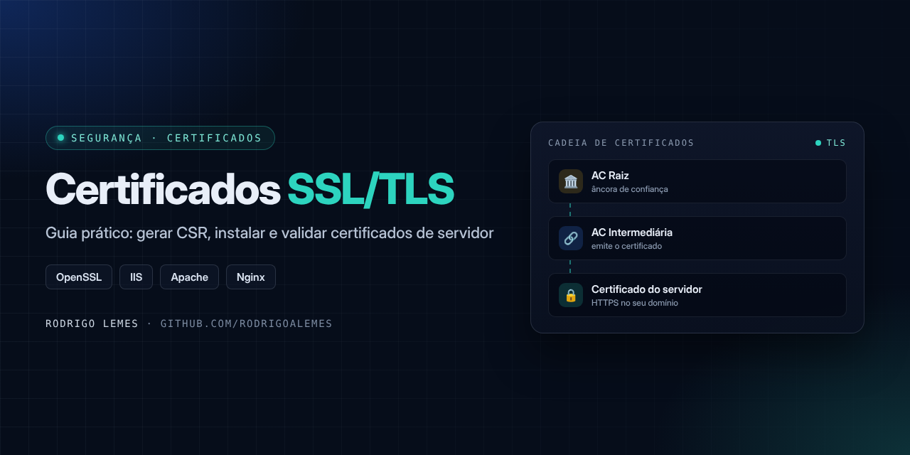
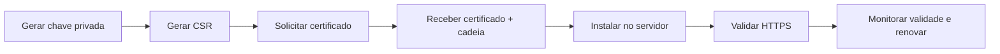

<p align="center">

</p>

<h1 align="center">Certificados SSL/TLS — guia prático</h1>
<p align="center"><i>Gerar CSR, instalar e validar certificados de servidor</i></p>

<p align="center">


</p>

## Sumário

- [Sobre](#sobre)
- [Visão geral do processo](#visão-geral-do-processo)
- [Guias](#guias)
- [Checklist rápido](#checklist-rápido)
- [Estrutura do repositório](#estrutura-do-repositório)
- [Autor](#autor)

## Sobre

Guia de referência para o ciclo de um **certificado SSL/TLS de servidor**, do pedido à validação, reunido a partir da experiência com emissão de certificados **ICPEdu**. O conteúdo é genérico e não contém dados de nenhum ambiente.

> [!IMPORTANT]
> O fluxo de solicitação e aprovação do certificado depende da instituição emissora. Siga sempre as orientações oficiais dela; este guia cobre as etapas técnicas no servidor.

## Visão geral do processo



## Guias

| Etapa | Documento |
| --- | --- |
| 1. Gerar chave e CSR com OpenSSL | [docs/01-gerar-csr.md](docs/01-gerar-csr.md) |
| 2. Instalar no servidor (Apache, Nginx, IIS) | [docs/02-instalar.md](docs/02-instalar.md) |
| 3. Validar e renovar | [docs/03-validar.md](docs/03-validar.md) |

## Checklist rápido

- [ ] Chave privada gerada e guardada com acesso restrito
- [ ] CSR com o nome do domínio correto (CN/SAN)
- [ ] Certificado e **cadeia intermediária** instalados
- [ ] HTTPS validado em navegador e por linha de comando
- [ ] Data de expiração registrada e lembrete de renovação criado

## Estrutura do repositório

```text
ICPEdu-SSL/
├── assets/
│   └── capa.png
├── docs/
│   ├── 01-gerar-csr.md
│   ├── 02-instalar.md
│   └── 03-validar.md
└── README.md
```

## Autor

**Rodrigo Lemes** · Analista de TI · Microsoft 365, AD/Entra ID, Automação, Power BI e IA aplicada

[](https://www.linkedin.com/in/rodrigoalemes/)
[](https://github.com/rodrigoalemes)
